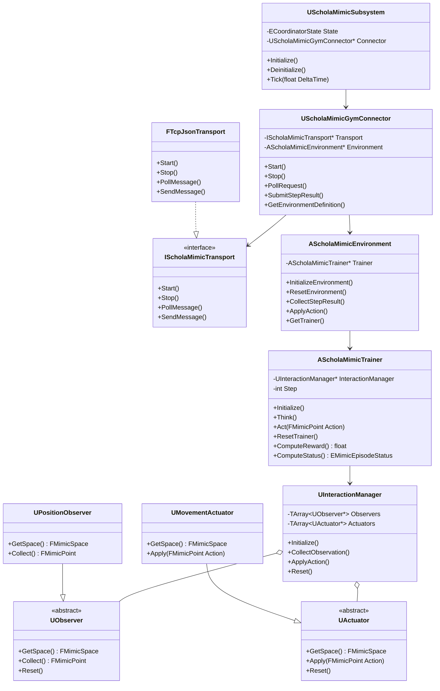
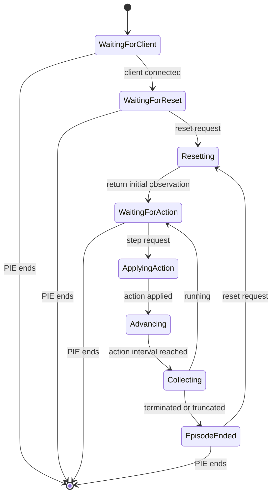
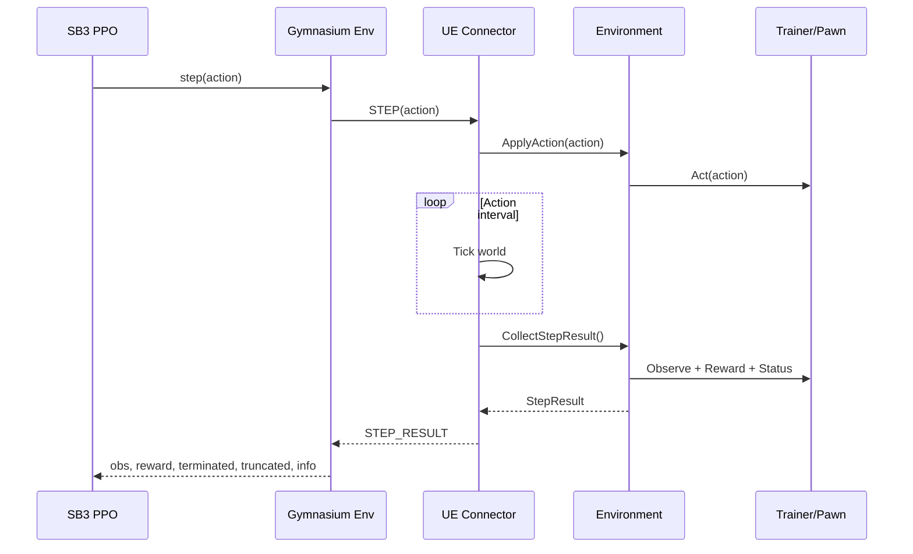

# Schola Mimic 技术设计文档

| 项目 | 内容 |
| --- | --- |
| 文档状态 | Draft v0.1 |
| 项目名称 | Schola Mimic |
| 项目位置 | `Schola-my-study-ver/Schola-mimic` |
| 参考实现 | AMD Schola 1.3 |
| 目标 UE 版本 | Unreal Engine 5.7 |
| Python 训练框架 | Gymnasium + Stable-Baselines3 PPO |
| 首个示例 | LineWorld |

## 1. 背景

Schola 在 Unreal Engine 和 Python 强化学习框架之间建立了一条训练与推理通路。完整项目还处理了多环境、多 Agent、不同空间类型、RLlib、SB3、模型导出、NNE 推理、配置管理、错误处理和构建分发等问题。

Schola Mimic 是一个个人学习项目。它不是 Schola 的替代品，也不追求生产级完整性。项目通过重新建立一条最小但真实可运行的训练闭环，理解以下问题：

1. UE 中的对象如何描述 observation、action、reward 和 episode 状态。
2. UE 游戏循环如何与 Python 的 `reset()` / `step()` 语义对齐。
3. Gymnasium 如何包装外部实时仿真。
4. PPO 如何通过该接口训练 UE 中的 Agent。
5. 训练策略如何导出，并在 UE 内执行推理。

## 2. 设计原则

### 2.1 保留边界，缩小能力

保留原版 Schola 最有教学价值的职责边界：

```text
Observer / Actuator
        ↓
InteractionManager
        ↓
Trainer / Brain
        ↓
Environment
        ↓
GymConnector
        ↓
Transport
        ↓
Python Core Env
        ↓
Gymnasium Env
        ↓
SB3
```

每层只实现第一个示例真正需要的能力。暂不为未来需求提前扩展。

### 2.2 允许直接复用原版代码

本项目允许复制、裁剪或改写原版 Schola 代码。复用代码不是问题，但应服务于学习：

- 通用样板、UE 反射声明、构建脚本和序列化代码可以直接复用。
- 决定系统行为的核心调度逻辑，第一遍优先自己实现。
- 难以独立验证的代码不能只因原版存在就复制。
- 每个明显复用的模块记录原文件、保留部分和修改部分。

记录来源的目的不是发布合规，而是区分“已经理解并重建”和“暂时借用”，方便回头学习。

### 2.3 两遍实现

第一遍建立透明、容易抓包和调试的最小系统：

- 单环境；
- 单 Agent；
- TCP + 长度前缀 JSON；
- 手动启动 Python；
- Gymnasium 单环境；
- SB3 PPO；
- Blueprint 实现 reward、status 和 reset；
- 不支持 UE 内 ONNX 推理。

第二遍再替换或增加接近原版的能力：

- protobuf + gRPC；
- Dict/Box/Discrete 等完整空间对象；
- 多环境向量化；
- UE NNE/ONNX 推理；
- 自动启动 Python；
- 更接近原版的配置系统。

第一遍不是最终通信方案，而是为了看清协议、时序和状态转换。

## 3. 目标和非目标

### 3.1 第一里程碑目标

从 SB3 调用：

```python
obs, info = env.reset()
obs, reward, terminated, truncated, info = env.step(action)
```

可以驱动 UE 中一个 Pawn，并完成至少 10,000 个训练 step。训练结束后，LineWorld Agent 到达目标的成功率应明显高于随机策略。

### 3.2 第一阶段非目标

- 多 Agent；
- 多个并行 UE Environment；
- RLlib、Minari 和模仿学习；
- Camera observation；
- recurrent policy；
- 自动恢复 checkpoint；
- TensorBoard 之外的日志后端；
- 网络安全、认证和公网通信；
- 异常断线恢复；
- 跨平台打包；
- Marketplace 或开源分发；
- 与原版 Schola 的资产、配置或协议兼容。

## 4. 项目结构

```text
Schola-my-study-ver/
├── docs/                              # 开发者学习文档
│   ├── README.md
│   └── technical-design-document.md
│
└── Schola-mimic/
    ├── README.md
    ├── docs/                          # 面向使用者的文档
    ├── examples/
    │   ├── line_world/
    │   └── train_line_world.py
    ├── protocol/
    │   ├── README.md
    │   └── schola_mimic.proto         # 第二遍实现时加入
    ├── python/
    │   ├── pyproject.toml
    │   ├── src/schola_mimic/
    │   │   ├── core/
    │   │   ├── gym/
    │   │   ├── sb3/
    │   │   └── transport/
    │   └── tests/
    └── Plugins/
        └── ScholaMimic/
            ├── ScholaMimic.uplugin
            ├── Config/
            ├── Content/
            ├── Resources/
            └── Source/
                └── ScholaMimic/
                    ├── Public/
                    └── Private/
```

UE 示例资产可以暂时放进插件 `Content/Examples/LineWorld`，避免第一阶段再维护独立示例项目。插件稳定后再决定是否拆出 `ScholaMimicExamples` 项目。

## 5. 系统上下文

```mermaid
flowchart LR
    SB3["SB3 PPO"] --> Gym["Gymnasium Env"]
    Gym --> Core["ScholaMimic Core Env"]
    Core --> Client["Python TCP Client"]
    Client <-->|"framed JSON"| Server["UE TCP Server"]
    Server --> Connector["Gym Connector"]
    Connector --> Environment["UE Environment"]
    Environment --> Trainer["Trainer"]
    Trainer --> Agent["Pawn"]
```



UE 进程是仿真端和 TCP Server。Python 进程是训练端和 TCP Client。Python 发起 `reset` 和 `step` 请求；UE 返回符合 Gymnasium 语义的状态。

## 6. UE 端设计

### 6.1 核心类图



### 6.2 `UScholaMimicSubsystem`

使用 `UTickableWorldSubsystem`，负责：

- Play 开始后寻找唯一的 `AScholaMimicEnvironment`；
- 创建并启动 Gym Connector；
- 在 Tick 中推进协调状态机；
- 在退出 Play 时关闭 socket 和工作线程；
- 记录核心状态转换日志。

Subsystem 不负责 reward、observation 或动作实现。它只负责编排。

### 6.3 `AScholaMimicEnvironment`

第一版只持有一个 Trainer，负责：

- 初始化 Trainer；
- 重置场景和 Trainer；
- 把 action 路由给 Trainer；
- 汇总 observation、reward 和 episode 状态；
- 暴露 Blueprint 可覆盖的 `InitializeEnvironment` 和 `ResetEnvironment`。

Environment 是 episode 边界的所有者。Trainer 结束时，由 Environment 决定何时执行 reset。

### 6.4 `AScholaMimicTrainer`

沿用原版“Trainer 是 Controller”的思路，第一版继承 `AAIController`，负责 Possess 一个 Pawn。

职责：

- 持有 Observer 和 Actuator；
- 收集当前 observation；
- 计算当前 step 的 reward；
- 判断 `Running`、`Terminated` 或 `Truncated`；
- 应用 action；
- 维护 episode step 计数；
- 调用 Blueprint 实现的任务逻辑。

Blueprint 接口：

```text
ComputeReward() -> float
ComputeStatus() -> EpisodeStatus
ResetTrainer()
GetInfo() -> Map<String, String>
```

第一版不引入完整 Brain/Policy 层。外部 Python 本身就是策略，Connector 收到 action 后直接交给 Trainer。第二阶段加入 `SynchronousBrain`，以便训练和 UE 内推理共用 Trainer。

### 6.5 `UInteractionManager`

负责把多个 Observer/Actuator 聚合为统一输入输出。即使 LineWorld 只有一个 Observer 和一个 Actuator，也保留该层，因为它是理解 Schola 组合机制的关键。

第一版只支持：

- Observer 按稳定名称生成 observation；
- Actuator 按稳定名称接收 action；
- 初始化时生成并缓存空间定义；
- reset 时通知所有子对象。

禁止依赖 `TArray` 下标作为跨进程协议标识。协议中使用稳定字符串名称。

### 6.6 Observer 和 Actuator

第一版实现：

```text
UPositionObserver
  输出：相对起点归一化后的 X 坐标
  空间：Box(low=-1, high=1, shape=[1])

UMovementActuator
  输入：X 方向强度
  空间：Box(low=-1, high=1, shape=[1])
```

第二个示例再增加：

- `URayCastObserver`；
- 二维 `UMovementActuator`；
- `UDiscreteActuator` 或离散空间包装。

## 7. 数据模型

### 7.1 Space

第一版支持 `Box`，但保留可扩展的 tagged representation：

```json
{
  "type": "box",
  "low": [-1.0],
  "high": [1.0],
  "shape": [1]
}
```

后续增加：

```text
Discrete
Dict<String, Space>
```

### 7.2 Point

Point 是某个 Space 中的一次具体取值：

```json
{
  "position_x": [0.25]
}
```

第一版 UE 内部可以用简单结构：

```cpp
USTRUCT()
struct FMimicFloatArray
{
    GENERATED_BODY()

    UPROPERTY()
    TArray<float> Values;
};

using FMimicNamedPoint = TMap<FString, FMimicFloatArray>;
```

如果 Unreal Header Tool 或容器限制使别名不适合 Blueprint，则使用 `USTRUCT` 包装 `TMap`。

### 7.3 StepResult

```text
observation : NamedPoint
reward      : float
terminated  : bool
truncated   : bool
info        : Map<String, String>
episode_id  : int
step_id     : int
```

`terminated` 表示任务自然结束，例如到达目标；`truncated` 表示达到最大步数等外部限制。二者不能在正常路径中同时为 true。

## 8. 通信协议 v0

### 8.1 Transport

使用单客户端 TCP：

- UE 监听 `127.0.0.1:50051`；
- Python 主动连接；
- 每条消息为 `4-byte little-endian payload length + UTF-8 JSON`；
- 每个连接串行处理请求；
- 同一时刻最多有一个未完成请求；
- 最大消息长度暂定 1 MiB。

网络读取放在工作线程中，游戏线程只轮询线程安全队列。禁止在游戏线程执行阻塞式 `accept()` 或 `recv()`。

### 8.2 消息

握手：

```json
{
  "type": "hello",
  "protocol_version": 1
}
```

环境定义响应：

```json
{
  "type": "hello_result",
  "protocol_version": 1,
  "observation_space": {
    "position_x": {
      "type": "box",
      "low": [-1.0],
      "high": [1.0],
      "shape": [1]
    }
  },
  "action_space": {
    "move_x": {
      "type": "box",
      "low": [-1.0],
      "high": [1.0],
      "shape": [1]
    }
  }
}
```

重置：

```json
{
  "type": "reset",
  "request_id": 1,
  "seed": 42,
  "options": {}
}
```

动作：

```json
{
  "type": "step",
  "request_id": 2,
  "action": {
    "move_x": [0.8]
  }
}
```

状态：

```json
{
  "type": "step_result",
  "request_id": 2,
  "observation": {
    "position_x": [0.25]
  },
  "reward": -0.01,
  "terminated": false,
  "truncated": false,
  "info": {},
  "episode_id": 3,
  "step_id": 17
}
```

关闭：

```json
{
  "type": "close",
  "request_id": 3
}
```

### 8.3 协议不变量

- 响应必须回传原 `request_id`。
- `step` 只能在成功 `reset` 后发送。
- episode 结束后，下一条有效命令只能是 `reset`。
- action 的 key、shape 和范围必须符合 hello 中的定义。
- 非法状态返回 `error`，不能静默忽略。
- 第一版断线后终止训练会话，不自动重连。

## 9. UE Tick 与 Gym Step 对齐

### 9.1 协调状态机



### 9.2 Step 时序



### 9.3 第一版的时间语义

- 默认一个 action 保持 `ActionRepeat` 个 UE Tick；
- `ActionRepeat` 默认 1；
- 等待 Python action 时不重复推进 Agent 动作；
- LineWorld 使用显式位置更新，避免物理世界在网络等待期间引入难以解释的变化；
- 不在游戏线程阻塞等待 Python；
- 不承诺真实时间确定性，只承诺 step 顺序确定。

后续如需物理训练，再研究固定时间步、暂停世界、异步推理以及原版 `SynchronousBrain` 的处理方式。

## 10. Python 端设计

### 10.1 类图

```mermaid
classDiagram
    class TcpJsonConnection {
        +connect()
        +request(message) dict
        +close()
    }

    class ScholaMimicEnv {
        +start()
        +reset(seed, options)
        +step(action)
        +close()
        +observation_space
        +action_space
        -TcpJsonConnection connection
    }

    class GymEnv {
        +reset(seed, options)
        +step(action)
        +close()
        +gym.Space observation_space
        +gym.Space action_space
        -ScholaMimicEnv core_env
    }

    class SB3PPO {
        +learn()
        +save()
    }

    ScholaMimicEnv --> TcpJsonConnection
    GymEnv --> ScholaMimicEnv
    SB3PPO --> GymEnv
```



### 10.2 分层

`transport`：

- socket 连接；
- framing；
- JSON 编解码；
- request/response ID 校验；
- 超时。

`core`：

- 协议状态；
- Space 定义转换；
- `reset` / `step`；
- 与 Gymnasium 无关。

`gym`：

- 继承 `gymnasium.Env`；
- 把 Mimic Space 转换为 `gymnasium.spaces`；
- 执行 Gym API 检查；
- 不包含 SB3 专用逻辑。

`sb3`：

- PPO 启动参数；
- TensorBoard、checkpoint 和最终模型保存；
- 不改变 Gym 环境语义。

### 10.3 训练入口

第一版使用显式脚本，不由 UE 自动启动：

```python
env = GymEnv(host="127.0.0.1", port=50051)
model = PPO("MultiInputPolicy", env, verbose=1)
model.learn(total_timesteps=10_000)
model.save("line_world_ppo")
```

如果第一版空间直接展开为一维 `Box`，可以使用 `MlpPolicy`。是否保留 Dict 由首次实现时的复杂度决定，但跨进程协议仍使用名称映射。

## 11. LineWorld 示例

### 11.1 场景

- 一条 X 轴路线；
- Agent 起点为 `X = 0`；
- 目标点为 `X = 1000 cm`；
- Agent 位置限制在 `[-100, 1100]`；
- 最大 episode 长度为 200 step。

### 11.2 Observation

```text
position_x = clamp((AgentX - StartX) / (GoalX - StartX), -1, 1.1)
```

协议空间第一版可以声明为 `[-1, 1.1]`，不应声明为 `[-1, 1]` 后再返回 1.1。

### 11.3 Action

```text
move_x ∈ [-1, 1]
AgentX += move_x * MoveDistancePerStep
```

`MoveDistancePerStep` 默认 25 cm。

### 11.4 Reward

```text
progress = previous_distance_to_goal - current_distance_to_goal
reward = progress / MoveDistancePerStep
reward -= 0.01

到达目标：reward += 10
越过左边界：reward -= 2
```

训练阶段可以使用距离进展作为 shaping。该示例用于验证系统，不用于测试泛化能力。

### 11.5 Episode 状态

- `AgentX >= GoalX`：`terminated = true`；
- `step >= MaxEpisodeSteps`：`truncated = true`；
- 其他情况：运行中。

### 11.6 Reset

- Agent 回到起点；
- 清零速度和动作；
- 清零 step；
- 更新 previous distance；
- episode ID 加一；
- 返回 reset 后的初始 observation，reward 不参与学习。

## 12. 原版代码复用计划

| 模块 | 第一遍策略 | 第二遍策略 | 原版参考位置 |
| --- | --- | --- | --- |
| Observer/Actuator 接口 | 参考后重写最小接口 | 按需复制包装器 | `Source/Schola/*/Observers`、`Actuators` |
| InteractionManager | 自己实现聚合逻辑 | 比较并补齐 Dict 支持 | `Common/InteractionManager.*` |
| Trainer | 参考类职责，自行重写 | 可复制状态结构 | `Training/AbstractTrainer.*` |
| Environment | 自己实现单 Agent 版本 | 再增加 Static/Dynamic | `Environment/*` |
| Subsystem Tick | 自己实现状态机 | 与原版逐行对照 | `Subsystem/ScholaManagerSubsystem.*` |
| Socket/线程样板 | 可直接借用 UE 常见实现 | 可替换为原版 gRPC backend | `Communicator/*` |
| JSON 序列化 | 使用 UE JSON API | 替换 protobuf | `ProtobufSerializer.*` |
| Python Core Env | 参考 API，自行重写 | 借用 ID/空间工具 | `Resources/python/schola/core` |
| Gym Env | 可直接参考并裁剪 | 增加 VectorEnv | `Resources/python/schola/gym/env.py` |
| SB3 启动脚本 | 可直接裁剪 | 增加 checkpoint/ONNX | `Resources/python/schola/scripts/sb3` |
| protobuf/gRPC | 第一遍不使用 | 可直接复用 proto、生成代码和构建脚本 | `Proto`、`Generated`、`Resources/Build` |
| NNE inference | 第一遍不使用 | 可直接复制并逐段解释 | `Policies/InferencePolicy.*` |

每次复用建议在对应源文件头部加入学习注释：

```text
Learning source: Schola 1.3, <relative path>
Reuse type: copied / simplified / rewritten
Changes: <short description>
```

## 13. 日志与可调试性

UE 日志至少包括：

- Subsystem 初始化和关闭；
- 环境与 Trainer 注册；
- 客户端连接和断开；
- 每次 reset；
- episode 结束原因和累计 reward；
- 协议错误；
- transport 线程错误。

默认不逐 step 打印。通过 `LogVerbosity=VeryVerbose` 开启 observation/action 详情，避免训练日志淹没真正问题。

Python 使用标准 `logging`：

- INFO：连接、环境定义、reset、episode 汇总；
- DEBUG：每条请求和响应；
- ERROR：协议不匹配、超时和断线。

调试 JSON 时不得依赖 UE Output Log 是唯一输出来源；启动 UE 的终端和磁盘日志也应可查。

## 14. 错误处理

第一版只实现能显著降低调试成本的检查：

- 端口绑定失败立即报错；
- 消息超过最大长度时断开；
- JSON 解析失败返回错误并结束会话；
- 未 reset 就 step 返回状态错误；
- action key 或 shape 不一致时拒绝执行；
- observation 包含 NaN/Inf 时拒绝返回；
- 请求超过 Python 超时后训练中止；
- PIE 结束时通知 Python 或关闭连接。

不实现自动重试、恢复或高可用。

## 15. 测试设计

虽然本文的 TDD 指技术设计文档，项目仍需要自动化测试。

### 15.1 Python 单元测试

- 长度前缀编码和拆包；
- 半包、粘包处理；
- Space JSON 转 Gym Space；
- request ID 不一致；
- Gym `reset` / `step` 返回类型；
- terminated 与 truncated 映射。

### 15.2 UE 自动化测试

- Box space 校验；
- PositionObserver 数值；
- MovementActuator 边界；
- InteractionManager 聚合 key；
- Trainer reset 后状态；
- 协调状态机非法转换。

### 15.3 协议集成测试

使用 Python 假 Server 测试 Client，使用 Python 假 Client 测试 UE Server。完整 UE + Python 测试验证：

1. hello 获得空间；
2. reset 获得初始 observation；
3. 固定正 action 使位置递增；
4. 到达目标时 terminated；
5. 再 reset 后 episode ID 和位置正确。

### 15.4 训练验收

- 随机策略运行 100 个 episode，记录成功率和平均步数；
- PPO 训练 10,000 step；
- 再评估 100 个 episode；
- PPO 成功率显著高于随机策略；
- 无 socket 死锁、UE crash 或 observation shape 变化。

## 16. 实现阶段与验收门

### M0：项目骨架

交付：

- UE 插件可被 UE 5.7 编译加载；
- Python 包可 editable install；
- 两侧都有最小测试入口。

验收：空插件启动和退出无错误。

### M1：Transport

交付：

- UE TCP Server；
- Python TCP Client；
- framed JSON；
- hello/close。

验收：连续完成 1,000 次 echo，不发生错包或死锁。

### M2：Environment Definition

交付：

- Box Space；
- Observer/Actuator 抽象；
- InteractionManager；
- hello 返回空间。

验收：Python 创建出的 Gym Space 与 UE 定义一致。

### M3：Gym 闭环

交付：

- Environment、Trainer 和 Subsystem 状态机；
- reset/step；
- LineWorld Blueprint。

验收：Python 固定动作能稳定完成 100 个 episode。

### M4：SB3 训练

交付：

- Gymnasium Env；
- PPO 训练脚本；
- TensorBoard；
- checkpoint 和 final model。

验收：完成 10,000 step，策略优于随机基线。

### M5：结构对照

交付：

- 对照原版逐模块记录差异；
- 判断哪些第一版简化会阻碍 Maze 示例；
- 引入 Brain/Policy 层。

验收：训练接口不变，内部改造后 LineWorld 回归测试通过。

### M6：LocalMaze

交付：

- RayCastObserver；
- 二维 MovementActuator；
- 局部墙体/目标感知；
- 随机起点、目标和迷宫布局。

验收：验证“无记忆、无全局目标方向”的局部反应策略及其泛化边界。

### M7：原版协议与推理

交付：

- protobuf/gRPC 实验分支；
- ONNX 导出；
- UE NNE inference；
- 与 v0 TCP/JSON 的性能和复杂度对比。

验收：同一策略可在不启动 Python 的情况下由 UE 推理。

## 17. 关键决策记录

### D-001：第一版使用 TCP + JSON

原因：可直接观察消息，构建依赖少，便于理解 Gym step 与 UE Tick 的映射。代价是性能较低且不能直接兼容原版。

### D-002：第一版只支持单环境单 Agent

原因：多环境和多 Agent 会把 ID 映射、批处理、reset 语义同时引入，遮住基本闭环。类接口避免主动阻止未来扩展，但不提前实现。

### D-003：第一版使用 SB3 PPO

原因：依赖和启动路径比 RLlib 简单，当前示例已验证 SB3 可用。训练框架位于 Gymnasium 之上，不进入 UE 核心设计。

### D-004：保留 InteractionManager

原因：它体现 Schola 如何组合不同 Observer 和 Actuator，是核心学习目标。即使 LineWorld 用不到复杂聚合，也不把它直接折叠进 Trainer。

### D-005：暂缓 Brain/Policy

原因：外部训练闭环中 Python 已承担策略职责。第一版直接路由 action 可以减少异步 Future 和推理模式。完成闭环后再加入该层，以理解训练策略与本地推理的统一。

### D-006：允许复制原版代码

原因：项目目标是理解系统，而不是证明所有样板代码都能从零写出。核心调度先重建，基础设施按学习收益决定复制、裁剪或重写。

## 18. 待验证问题

这些问题不阻塞 M0，但应在对应阶段用实验回答：

1. UE 5.7 中最简单可靠的 socket 工作线程退出方式是什么？
2. `AAIController` 作为 Trainer 是否给 LineWorld 带来不必要的生命周期复杂度？
3. 第一版 Gym observation 应暴露 Dict 还是扁平 Box？
4. 等待 Python action 时，复杂物理场景需要怎样控制 World Tick？
5. 原版 gRPC 的异步模型解决了哪些 v0 协议会遇到的具体问题？
6. NNE 导入带外部 `.onnx.data` 的模型时，资产流程应如何固定？

## 19. 完成定义

Schola Mimic 的第一学习周期完成，不以代码量或原版 API 覆盖率判断，而以以下结果判断：

- 可以解释从 UE observation 到 PPO action 的完整调用与数据路径；
- 可以解释 UE Tick 和 Gym step 为什么不是同一个循环；
- 可以独立定位通信、空间、reward、reset 或推理问题属于哪一层；
- LineWorld 可以训练；
- LocalMaze 可以演示局部反应策略的能力和限制；
- 可以明确说明 Mimic 与原版 Schola 在通信、调度、并行和推理上的差异。

